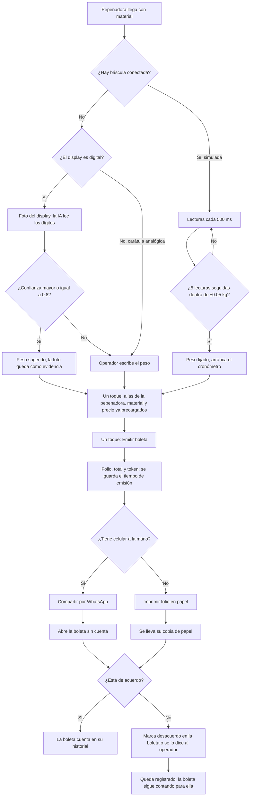
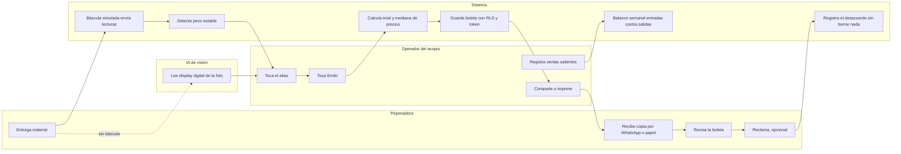

# PACKET — Semana 11 · Mi Boleta

**Nicolas Martinez (OPERATOR)** · Team T4 · Crystal Ball Studio · Capítulo 10, *Dreaming of Plenitude* · Vacío primario: **Pepenador rails**
Stack floor: 🐉 DRAGON — IoT/sensing + ML (visión) + marketplace logic

**Mi declaración en el Blueprint T4:** pilotear un flujo de boleta de **5 segundos** en un acopio, cumpliendo las condiciones 1–2. Este slice también cumple las condiciones 4, 5 y 6 dentro del código. La condición 3 no depende del código (sección 9).

> El Blueprint T4 sigue en borrador: el voto entre Pepenador rails y agua está pendiente. Este packet asume Pepenador rails como vacío primario, como dice el Blueprint.

> Todo dato de pepenadoras, acopios, precios y ventas en este proyecto es **inventado y etiquetado**. La báscula es **simulada** y lo dice en pantalla.

---

## 1. El problema, en mis palabras

La pepenadora no es invisible: la ven todos los días, pero **desde la libreta del comprador**. Llega al centro de acopio, el dueño pesa, dice un número, paga en efectivo y el registro se queda del lado de quien compra. Ella se va sin papel: no puede reclamar un peso mal leído, no puede comparar el precio que le pagaron y no tiene cómo probar cuántos kilos movió en el año.

Ver no es arreglar (hecho acordado por T4): una boleta solo sirve si llega a la mano de quien vende, tiene una ruta para reclamar y no le exige nada que no tenga: ni RFC, ni cuenta bancaria, ni app, ni smartphone.

## 2. Usuario exacto

**Primario (quien opera la app):** el operador de un centro de acopio chico en la periferia de CDMX. Pesa entre 30 y 80 entregas al día con una báscula de plataforma, tiene fila, manos sucias, celular Android y vive en WhatsApp. Hoy anota en libreta. Si la boleta le cuesta más de 5 segundos por entrega, no la usa.

**Secundario (quien recibe el valor):** la persona pepenadora que le vende a ese acopio. Puede no tener celular, lee despacio, no tiene cuenta en nada y desconfía de los links. Su copia puede ser **de papel**.

## 3. Definición de éxito

> **Antes de que cierre el módulo:** con la báscula simulada en ESTABLE, el operador emite una boleta en **≤ 5 segundos y ≤ 2 toques** (pepenadora → Emitir), medido por la app. La boleta lleva peso, material, precio por kilo, total, fecha, acopio y ruta de reclamo. La pepenadora recibe su copia **por WhatsApp o como folio impreso**. Si la abre en un celular sin cuenta, puede marcar "No estoy de acuerdo" sin que su boleta desaparezca de su historial.

## 4. 🎨 Mockup (generado con imagen)


Prompt para generar el mockup:

> Mobile app UI mockup, three panels side by side, clean flat design, high contrast, large type, Spanish text. PANEL 1, phone screen "Nueva entrega": big live weight "23.40 kg" with a green "ESTABLE" chip, yellow badge "BÁSCULA SIMULADA", a row of large round buttons with pepenador aliases "Lupe · Toño · Chela · + Nueva", PET chip preselected with "$5.50/kg", one huge navy button "Emitir boleta", small timer text "2.8 s". PANEL 2, phone screen "Boleta A-0142": "Acopio La Esperanza (ejemplo)", date, huge "23.40 kg PET", "$5.50/kg · Total $128.70", gray line "Mediana de la zona: $5.20/kg (excluye 2 acopios con pocos datos)", green button "Compartir por WhatsApp", button "Imprimir folio", outlined button "No estoy de acuerdo". PANEL 3: a small printed paper receipt, 58 mm thermal style, with folio "A-0142", weight, material, price, total, date, acopio, a QR code, and the line "¿No estás de acuerdo? Dilo al operador o manda este folio por WhatsApp". No stars, no ratings, no scores, no map pins anywhere. Navy #1F3A5F accent, white background.

## 5. 📊 Flujo

### 5.1 Cómo funciona la feature



### 5.2 Swimlane: quién hace qué



## 6. 🌍 Benchmark

**La mejor solución existente en la Tierra para esto es** el esquema colombiano de remuneración a recicladores de oficio (Decreto 596 de 2016): las Estaciones de Clasificación y Aprovechamiento pesan, emiten soporte por reciclador y la tarifa de aseo paga por tonelada verificada.

**La mía difiere / localiza en que** México no tiene ese cobro vía tarifa ni padrón de recicladores, así que el riel empieza donde ya existe el pesaje —la báscula privada del acopio— y entrega la copia por WhatsApp o en papel, sin RFC, cuenta bancaria ni app, con un piloto voluntario pagado por una marca en lugar de un ingreso REP que la ley todavía no ha reglamentado.

## 7. 🔭 Visión a 3 años (light charter)

Si este slice funciona en un acopio, Mi Boleta se vuelve el registro por defecto entre pepenadora y comprador en los acopios de la periferia: básculas reales conectadas, copia en papel o WhatsApp en cada entrega y un premio por kilo pagado primero por marcas voluntarias y, cuando se reglamente la LGEC, por la REP. La verificación vive en la báscula y en las facturas de salida del acopio, nunca en fotos de la persona ni en su ubicación. El historial es suyo y portátil, y nunca se convierte en score.

## 8. ✅ Condiciones del Blueprint → cómo las cumple este slice

| # | Condición | Implementación en el slice |
|---|---|---|
| 1 | Sin RFC, cuenta bancaria, app ni smartphone; alternativa en papel | La pepenadora no tiene cuenta. La boleta se abre en cualquier navegador o **se imprime como folio** (formato 58 mm con QR). El alias es el único dato obligatorio. |
| 2 | Peso, material, precio unitario, total, fecha, acopio y ruta de reclamo; copia para la trabajadora | Los 7 campos son obligatorios en la boleta y en el folio impreso. Ruta de reclamo en ambos: botón "No estoy de acuerdo" o decírselo al operador, que lo registra por ella. |
| 3 | Dueño de acopio y patrocinador comprometidos antes del desarrollo | **Fuera del código.** El acopio y el patrocinador del slice son inventados y etiquetados. El compromiso real es un pendiente de Money (Miguel) y mío antes de cualquier piloto. |
| 4 | Validar contra báscula y facturas de salida; foto = evidencia, no prueba; carátula analógica a mano; fraude en muchas transacciones; la marca dice "inconsistente", nunca la causa | Cada boleta guarda su `fuente` (báscula / foto IA / manual) y la foto como evidencia. La carátula analógica siempre va a mano. Balance semanal por acopio y material: kilos de boletas contra kilos de **ventas salientes** registradas. Si no cuadran, se marca **"inconsistente"** a nivel acopio-semana, nunca en una boleta ni en una persona. Las pruebas técnicas de Andrés (lectura de display, prueba de fraude en muchas transacciones) se conectan aquí. |
| 5 | Sin score, ranking, geolocalización ni castigo; historial de la trabajadora; marcas solo agregados; la medición no se vota; cada filtro publica a quién deja fuera | No hay score, estrellas, ranking ni colores sobre personas. No se pide ubicación. La pepenadora nunca tiene que confirmar: la boleta cuenta para ella desde que se emite, y un desacuerdo no la borra. El operador no puede eliminar boletas, solo anularlas con motivo visible. La mediana de precios y el balance **dicen qué excluyen** ("excluye 2 acopios con menos de 5 boletas"). |
| 6 | Probar si la transparencia mejora el pago neto y las disputas; detenerse si sube la represalia, exclusión o mal uso | Métricas y criterios de paro escritos **antes** de tener datos (sección 13). |

## 9. ✂️ Lo que NO construyo esta semana

- Compromiso real de acopio y patrocinador (condición 3, fuera del código)
- WhatsApp Business API → uso un link `wa.me` con texto prellenado
- Pagos, SPEI, CoDi o cálculo del premio por kilo
- Dashboard para marcas o patrocinadores
- Boleta autodeclarada por la pepenadora cuando el acopio no emite (siguiente slice)
- Báscula física, lectura de carátulas analógicas con IA, integración CFDI real
- GPS, rastreo de rutas o cualquier dato de ubicación de la persona
- **Score, estrellas, ranking, colores de confianza o cualquier evaluación de la persona** (condición 5; es lo que evita el error de Moola)
- Campañas de concientización o tips de reciclaje (zona prohibida)

## 10. Arquitectura

```
[Báscula simulada (página autenticada)]
        │ inserta lecturas (RLS: solo su acopio)
        ▼
[Supabase: scale_readings] ──Realtime──► [Captura /app/nueva (Next.js)]
                                                │  cronómetro ESTABLE → Emitir
      [Foto display digital] ──► /api/vision ──► Gemini Flash (key en Vercel env)
                                                ▼
              [Supabase: boletas, pepenadores, precios, ventas_salientes] (RLS por dueño)
                     │                                   │
   RPC get_boleta(token) / registrar_desacuerdo     Vista balance_semanal
                     ▼                                   ▼
   /b/[token] pública (sin PII)                 /app/balance: "consistente" / "inconsistente"
   /b/[token]/imprimir (folio 58 mm + QR)       a nivel acopio-material-semana
```

**Capas del Dragon Stack:**

| Capa | Qué hace en Mi Boleta | Etiqueta en pantalla |
|---|---|---|
| IoT / sensing | Báscula simulada que emite lecturas con ruido cada 500 ms; detección de estabilidad (5 lecturas dentro de ±0.05 kg) que fija el peso y arranca el cronómetro de 5 s. | "BÁSCULA SIMULADA" |
| ML (visión) | Solo si no hay báscula conectada: el modelo lee los dígitos de un **display digital** (MeasureBench: ~80% en displays digitales y 10–32% en carátulas, por eso las carátulas van a mano). Con confianza menor a 0.8, el operador escribe el peso. | "Lectura IA — sugerencia" |
| Marketplace logic | Precios por material por acopio; la boleta compara el precio pagado con la mediana de la zona y dice qué acopios quedan fuera del cálculo. | "Precios de ejemplo" |

## 11. Stack

| Pieza | Herramienta | Costo |
|---|---|---|
| Frontend + API routes | Next.js (App Router) + TypeScript + Tailwind | Gratis |
| Hosting | Vercel (Hobby) | Gratis |
| Base de datos + Realtime | Supabase (Free) | Gratis |
| Auth | Supabase Auth — Sign in with Google | Gratis |
| Fotos del display | Supabase Storage (bucket privado, URLs firmadas) | Gratis |
| Visión | Gemini Flash vía Google AI Studio (free tier; modelo en `GEMINI_MODEL`) | Gratis |
| Folio impreso | Página HTML con CSS `@media print` 58 mm + QR (librería `qrcode`) | Gratis |
| Validación | zod | Gratis |
| Envío por WhatsApp | Link `wa.me` con texto prellenado | Gratis |
| Repo | GitHub | Gratis |

## 12. 🛡️ Security floor

| Check | Implementación |
|---|---|
| 🔑 Sin secrets en el repo | `GEMINI_API_KEY` y `SUPABASE_SERVICE_ROLE_KEY` solo en Vercel env. `.env.local` en `.gitignore` desde el primer commit. El cliente solo ve la anon key. |
| 🔐 Auth | El operador entra con Google (Supabase Auth). La pepenadora no tiene cuenta, y la vista pública y el folio muestran solo su alias, nunca teléfono ni nombre real. |
| 🚪 RLS | RLS en todas las tablas. El operador solo ve filas de su acopio. Acceso público solo por funciones `security definer` con token UUID v4 y campos mínimos. |
| 🧹 Validación | zod en cliente y servidor: kg 0.01–2000; alias 2–40 caracteres (letras, espacios, guion); teléfono opcional de 10 dígitos; nota ≤ 280; motivo de anulación ≤ 140; imagen JPEG/PNG ≤ 5 MB. Al modelo solo va la imagen; su respuesta se valida como JSON con zod. |
| 🎭 Datos inventados | Seed con acopios, alias, precios y ventas salientes inventados, marcados "(ejemplo)". |

## 13. Métricas y criterios de paro (condición 6, escritos antes de los datos)

**Lo que mide la app desde el día uno:**
- Tiempo de ESTABLE a folio emitido (mediana y p90). Meta: mediana ≤ 5 s.
- Porcentaje de boletas por fuente: báscula, foto IA y manual.
- Porcentaje de boletas impresas contra las compartidas por WhatsApp.
- Porcentaje de boletas en desacuerdo y tiempo hasta que el acopio responde.
- Precio pagado por kilo contra la mediana de la zona, por material.

**El piloto real se detiene si:**
- Una pepenadora reporta que el acopio le compró menos, le pagó menos o la rechazó después de reclamar.
- El precio neto por kilo de las pepenadoras con boleta baja frente a las 4 semanas anteriores al piloto.
- Algún dato personal sale del acopio que lo capturó.
- La mediana de emisión pasa de 15 s durante dos semanas seguidas, porque eso significa que el operador volvió a la libreta.

## 14. Plan de pruebas

### 🔧 Pase mecánico

| # | Caso | Resultado esperado |
|---|---|---|
| 1 | Login con Google y logout | Entra a /app; sin sesión, /app redirige a /login |
| 2 | Báscula simulada a 23.4 kg | ESTABLE en ≤ 3 s |
| 3 | Báscula en modo "inestable" (±0.3 kg) | Nunca ESTABLE; Emitir deshabilitado |
| 4 | **De ESTABLE a folio con 2 toques** | Cronómetro ≤ 5 s; `emision_ms` guardado en la boleta |
| 5 | Foto de display digital legible | IA prellena kg; fuente `foto_ia`; foto guardada como evidencia |
| 6 | Foto de carátula analógica o borrosa | Sin prellenado; input manual con foco; fuente `manual` |
| 7 | kg = -1, 0, 2001, "abc"; alias `<script>` | Rechazado con mensaje claro, no llega a la BD |
| 8 | Boleta emitida | Tiene los 7 campos de la condición 2; total = kg × precio con 2 decimales |
| 9 | `/b/[token]` en incógnito | Abre sin login; sin teléfono ni nombre real |
| 10 | `/b/[token]/imprimir` | Cabe en 58 mm, trae los 7 campos, el QR abre la boleta y la ruta de reclamo está impresa |
| 11 | Token inventado | "Boleta no encontrada", sin filtrar si existe |
| 12 | RLS: usuario B consulta `boletas` del acopio A desde el navegador | 0 filas |
| 13 | Desacuerdo desde la boleta pública o desde el operador | Estado "en desacuerdo", sin duplicados; la boleta sigue en el historial |
| 14 | Operador intenta borrar una boleta | No hay botón ni permiso de borrado; solo anulación con motivo visible |
| 15 | Ventas salientes de PET 30% abajo de lo comprado en la semana | Balance "inconsistente" a nivel acopio-PET-semana; ninguna boleta ni persona marcada |
| 16 | Mediana con menos de 3 acopios | Se oculta y dice cuántos acopios excluyó y por qué |
| 17 | Repo | `git grep -i "api_key\|service_role"` no devuelve secretos |

Bug encontrado → fix → redeploy, documentado en `DECISIONS.md`.

### 🎭 Persona test

Dos personas, cada una en un chat nuevo, con capturas de cada pantalla en orden.

**Operador:**
> Eres Don Rigo, 58 años, dueño de un centro de acopio chico en Iztapalapa. Llevas 20 años anotando en libreta. Usas WhatsApp todo el día en un Android con la pantalla estrellada. Tienes las manos sucias y una fila de seis personas esperando. Si algo te quita más de cinco segundos por entrega, regresas a la libreta sin decir nada. Te voy a enseñar pantallas de una app, una por una. COMO DON RIGO, registra la entrega de Lupe, 23 kilos de PET, e imprímele su folio porque hoy no trae celular. Narra en voz alta dónde dudas, qué no entiendes y en qué momento dejarías la app.

**Pepenadora:**
> Eres Lupe, 47 años, recicladora de base desde hace 15. Hoy no traes celular; otros días usas el de tu hija. Lees despacio. Desconfías de los links porque "así te roban". Nunca has creado una cuenta en nada. Primero te enseño el folio de papel que te dio Don Rigo; después, lo que ves si abres el link en el celular de tu hija. COMO LUPE, di qué entiendes, qué no, si confías en lo que dice y si te atreverías a reclamar sabiendo que mañana le vas a volver a vender a Don Rigo.

Se registra cada confusión y se arregla la peor antes de la entrega.
